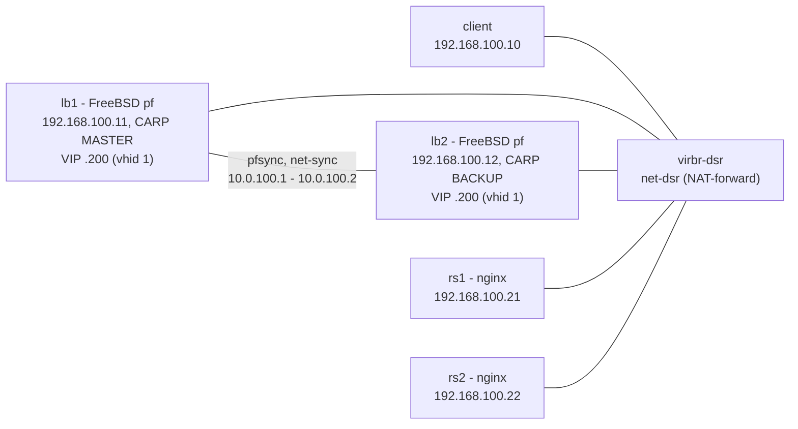
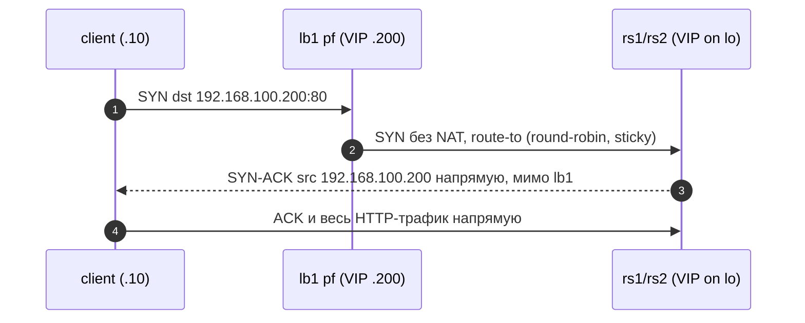

# lb-dsr-lab

Лаборатория на libvirt/QEMU: балансировка нагрузки с Direct Server Return
(DSR) на чистом pf во FreeBSD 14.5. Пару балансировщиков (lb1 + lb2, CARP)
перенаправляет HTTP-трафик на два бэкенда nginx (rs1/rs2) без NAT, а бэкенды
отвечают клиенту напрямую, минуя балансировщик, подставляя VIP со своего
loopback. Отдельная VM-клиент нагружает VIP. Всё работает в изолированных
libvirt-сетях: net-dsr (путь данных) и net-sync (pfsync).

## Что показывает лаборатория

- Классическую схему DSR: client -> VIP -> pf `route-to` -> backend -> ответ
  напрямую клиенту (src=VIP, мимо lb1).
- Почему для DSR нужны: VIP /32 на loopback бэкендов, `arp_ignore`/
  `arp_announce` (иначе бэкенды перехватят VIP на L2), sloppy-состояния на pf
  (он видит только одну половину каждого TCP-потока).
- Разницу DSR и NAT на живом трафике: `just pf-mode nat` / `just pf-mode dsr`
  (тесты t02 и t06 фиксируют сигнатуру каждого режима по SYN/SYN-ACK).

## Топология

Изолированная сеть libvirt `net-dsr` (мост `virbr-dsr`), 192.168.100.0/24,
хост — 192.168.100.1. Адреса гостей СТАТИЧЕСКИЕ (cloud-init network-config), DHCP отключён — детерминированность лабы.
VIP = 192.168.100.200/32.

| VM     | IP              | MAC               | RAM      | vCPU | ОС | Роль |
|--------|-----------------|-------------------|----------|------|----|------|
| client | 192.168.100.10  | 52:54:00:aa:00:10 | 512 MiB  | 1    | Debian 13 genericcloud | клиент |
| lb1    | 192.168.100.11  | 52:54:00:aa:00:11 | 2048 MiB | 1    | FreeBSD 14.5 BASIC-CLOUDINIT (ufs) | pf DSR, CARP MASTER (vhid 1, advskew 0) |
| lb2    | 192.168.100.12  | 52:54:00:aa:00:12 | 2048 MiB | 1    | FreeBSD 14.5 BASIC-CLOUDINIT (ufs) | pf DSR, CARP BACKUP (vhid 1, advskew 100) |
| rs1    | 192.168.100.21  | 52:54:00:aa:00:21 | 768 MiB  | 1    | Debian 13 genericcloud | nginx, VIP на lo |
| rs2    | 192.168.100.22  | 52:54:00:aa:00:22 | 768 MiB  | 1    | Debian 13 genericcloud | nginx, VIP на lo |

У обоих балансировщиков по два NIC: `vtnet0` — сегмент лаборатории (net-dsr),
`vtnet1` — выделенная sync-сеть `net-sync` (мост `virbr-sync`, чистый L2 без
IP на хосте), 10.0.100.0/30: lb1 = 10.0.100.1, lb2 = 10.0.100.2. По ней ходит
только pfsync.

Все диски — qcow2-оверлеи в пуле `default` (базовые тома
`freebsd-14.5-cloudinit.qcow2` и `debian-13-genericcloud.qcow2`), seed-ISO —
raw-тома `seed-*` (volid `cidata`).



Поток пакета в режиме DSR:



## Запуск

Sudo-шаги выполняет пользователь (не агент):

```bash
sudo pacman -S --needed libvirt qemu-full
sudo systemctl enable --now libvirtd.service
sudo usermod -aG libvirt "$USER"   # затем перелогиниться
sudo pacman -S --needed tcpdump wireshark-cli   # для дампов
sudo pacman -S --needed cdrtools xorriso        # для seed-ISO (mkisofs/xorriso)
```

Образы положить вручную (репозиторий ничего не скачивает):

```bash
mkdir -p ~/.local/share/lb-dsr-lab/images
# FreeBSD-14.5-RELEASE-amd64-BASIC-CLOUDINIT-ufs.qcow2  ->
cp <...> ~/.local/share/lb-dsr-lab/images/freebsd-14.5-cloudinit.qcow2
# debian-13-genericcloud-amd64.qcow2 ->
cp <...> ~/.local/share/lb-dsr-lab/images/debian-13-genericcloud.qcow2
```

Подъём и проверка:

```bash
just up        # сети, тома, seed-ISO, домены, ожидание адресов (до 300 с)
just status
just test-all  # t00..t07
```

Первый запуск занимает несколько минут: cloud-init ставит пакеты на Debian VM
(nginx и утилиты). SSH-ключ создаётся автоматически в
`~/.local/share/lb-dsr-lab/ssh/`; вход — пользователь `lab`.

## Снятие дампов

Всё с хоста — через sudo (подробности в `tests/capture-hints.md`):

```bash
sudo tcpdump -ni virbr-dsr                       # весь лабораторный мост
virsh -c qemu:///system domiflist lb1            # vnetX конкретной VM
sudo tcpdump -ni vnetX
# внутри lb1 (у lab NOPASSWD sudo):
just ssh lb1
sudo tcpdump -ni vtnet0 'tcp[tcpflags] & (tcp-syn|tcp-ack) == (tcp-syn|tcp-ack)'
```

Сигнатура DSR — на lb1 видны SYN к VIP, но НЕТ ни одного SYN-ACK от VIP:
ответы уходят напрямую от бэкенда клиенту. В NAT-режиме lb1 видит обе
половины потока и SYN-ACK от VIP появляется.

## Тестовая матрица

Запуск: `just test-all` (одиночный — `just test 02`).

| Тест | Что проверяет |
|------|---------------|
| t00-smoke | все 4 VM пингуются с хоста, `hostname` по SSH совпадает |
| t01-arp | на ARP к VIP отвечает только MAC lb1 (arp_ignore на бэкендах работает) |
| t02-dsr | ядро лаборатории: SYN к VIP есть на lb1, SYN-ACK от VIP — ноль, оба бэкенда отвечают |
| t03-sticky | sticky-address привязывает источник: хост и клиент каждый на своём бэкенде |
| t04-backend-failure | nginx на rs1 остановлен — ошибки; `pfctl -T delete` — трафик идёт на rs2; восстановление |
| t05-mtu | 2 МиБ `big.bin` через DSR без обрыва + DF-пинг 1400 байт до VIP |
| t06-nat-compare | в NAT-режиме SYN-ACK от VIP появляется на lb1 (симметричный путь), затем возврат в DSR |
| t07-carp-failover | lb1 гасится под живым циклом curl с клиента — lb2 забирает VIP (CARP BACKUP -> MASTER), lb1 восстанавливается |

## pf DSR vs NAT

- **DSR** (`freebsd/pf-dsr.conf`): `pass in ... route-to (vtnet0 <webs>)
  round-robin sticky-address keep state (sloppy)`. Пакет не переписывается;
  бэкенд отвечает клиенту напрямую. Плюсы: исходящий трафик не проходит через
  LB, масштабируется почти линейно, LB не становится узким местом аплинка.
  Минусы: pf видит половину потока (нужны sloppy-состояния), нет прозрачной
  трансляции, сложнее health-checking.
- **NAT** (`freebsd/pf-nat.conf`): `rdr pass ... -> <webs> round-robin
  sticky-address`. Симметричный путь — все ответы через lb1 (pf-mode.sh
  добавляет на бэкендах хост-маршруты через 192.168.100.11, иначе ответы уйдут
  напрямую к клиенту, у которого нет NAT-состояния). Плюс: полный
  контроль/видимость потока на LB. Минус: вся нагрузка идёт через lb1.
- FreeBSD 14.x держит только legacy-синтаксис pf: нет `match`/`rdr-to`/
  `nat-to` — используются `rdr pass` и `pass ... route-to`.

## Известные ограничения

- Чистый pf не умеет health-checks: падение бэкенда обнаруживается только
  тестом t04 и лечится вручную через `pfctl -t webs -T delete`.
- Sloppy-состояния — осознанный компромисс асимметрии DSR: pf не увидит FIN/RST
  обратного пути и держит «полу-потоки» до таймаута.
- `sticky-address` держит источник на одном бэкенде, пока живо состояние
  (и запись source tracking) — с одного IP распределения по бэкендам не будет.
- TCP-offloads (tso/lro/gso, rxcsum/txcsum) выключены на всех VM — иначе
  дампы на мосту нечитаемы (GSO-сегменты и checksums на virtio).
- В NAT-режиме реплаи бэкендов заворачиваются через lb1 хост-маршрутами — это
  временная мера режима сравнения, а не свойство DSR.

## Phase 2: CARP-пара (построено)

Второй балансировщик lb2 образует с lb1 CARP-пару поверх общего VIP:

- CARP: vhid 1, пароль `lbdsr`, VIP 192.168.100.200/32 как CARP-алиас на
  `vtnet0` обоих узлов; lb1 `advskew 0` (MASTER), lb2 `advskew 100` (BACKUP),
  `net.inet.carp.preempt=1` — восстановившийся lb1 возвращает себе MASTER.
  Виртуальный MAC пары — `00:00:5e:00:01:01`, поэтому переключение не требует
  обновления ARP-кэшей.
- pfsync: `pfsync0 syncdev vtnet1`, синхронизация таблицы состояний по
  выделенной сети `net-sync` (10.0.100.0/30, lb1 = .1, lb2 = .2, syncpeer —
  сосед). Правила pf для CARP/pfsync — с `(no-sync)`, чтобы управляющие
  состояния не реплицировались сами.
- Правило DSR не меняется: `route-to` работает поверх CARP-адреса на обоих
  узлах, `pf-dsr.conf` общий для пары (`just pf-mode` заливает его на lb1 и lb2).
- Отказоустойчивость проверяет тест t07: на клиенте запускается живой цикл
  из 120 curl, lb1 гасится (`shutdown -p now`), lb2 обязан подхватить VIP
  (не более 10 ошибок), затем lb1 поднимается обратно (`virsh start lb1`).
- Статус пары: `just carp` (carp-строка `ifconfig vtnet0` + `pfsync0` на
  обоих узлах).


## Troubleshooting (nuageinit first-boot flake)

FreeBSD's native cloud-init (nuageinit) is flaky on first boot: it may stop
after the `users` stage (lab user created, but write_files/runcmd skipped).
Symptoms: the VM has no static IP, no CARP alias, root SSH does not accept
the lab key. Fixes, in order of preference:

1. `just down && just up` for the affected node (wipe + fresh first boot) -
   usually enough; the flake is intermittent.
2. Deterministic repair without a wipe: stop the node
   (`virsh destroy lb1`), hot-attach its disk volume to the healthy node
   (`virsh attach-device lb2 disk.xml --live`), fix `/etc/rc.conf`,
   `/etc/pf.conf`, `/root/.ssh/authorized_keys`, `/etc/ssh/sshd_config`
   (PermitRootLogin yes) directly on the UFS mount, detach, start.
   The full procedure is documented in the project journal.

Required kernel modules: `carp.ko` and `pfsync.ko` are NOT in the FreeBSD
GENERIC kernel - they are loaded by cloud-init (`kldload`) and persisted via
`kld_list`. Without them the CARP alias fails with "Protocol not supported".


## Отчёты (reports/)

- [2026-10-22 — полный отчёт по фазам 1–2](reports/2026-10-22-full-report-phases-1-2.md) — архитектура, CARP+pfsync, отказоустойчивость.
- [2026-10-22 — пакетные доказательства](reports/2026-10-22-packet-capture-evidence.md) — аннотированные tcpdump-дампы DSR/NAT, pf-стейты.
- [2026-10-22 — отчёт об испытаниях](reports/2026-10-22-test-report-phases-1-2.md) — методика, матрица t00–t07, метрики, дефекты.

## pfkeeper — сервис управления (production-ready компонент)

`pfkeeper/` — Go control plane на каждом балансировщике: желаемое состояние
(таблицы, якорные правила, основной pf.conf) в git, применение через pfctl,
health-чеки бэкендов (http/tcp/icmp + **gojq по телу ответа**), peer-синхронизация
CARP-пары (single-writer = CARP MASTER, divergence guard, degraded-режимы),
gRPC + mTLS (RBAC: admin/operator/viewer/node), Prometheus-метрики, slog JSON,
rc.d. CLI `pfk`. Развёртывание: `bash pfkeeper/deploy/deploy.sh` (сборка
freebsd/amd64 + установка по SSH; для реального железа — `PFK_NODES`/`PFK_KEY`).

### Тестирование pfkeeper (2026-10-22…23)

| Уровень | Результат |
|---|---|
| Unit (8 пакетов, go test -race) | 57 PASS, 0 FAIL |
| t08 health-failover бэкенда | стоп nginx → member удалён из таблиц ОБОИХ узлов, трафик 100% на живой; возврат при восстановлении — PASS |
| t09 drift detect + heal | ручной pfctl не выживает: diff ловит, sync сходится — PASS |
| t10 mTLS + RBAC | без серта отказ; viewer read-only; node — только peering — PASS |
| t11 L7-глубина | HTTP 200 с телом, не прошедшим jq → member DOWN (jq_false); `health inspect` показывает тело, код и вывод jq — PASS |
| t12 peer-синхронизация | запись через BACKUP конвергентна на MASTER; diverged=false — PASS |
| Security-ревью | deployable as a lab; 4×P2 + 8×P3 задокументированы с фиксами |

Полные результаты и методики: `reports/2026-10-23-pfkeeper-testing-report.md`,
`reports/2026-10-22-security-review-pfkeeper.md`.

## Развёртывание на реальном железе

Пошаговый мануал (топология, FreeBSD, CARP/pfsync на физических NIC и коммутаторах,
Linux-бэкенды, pfkeeper, продакшен-безопасность, типовые проблемы):
**[docs/real-hardware-guide.md](docs/real-hardware-guide.md)**.
