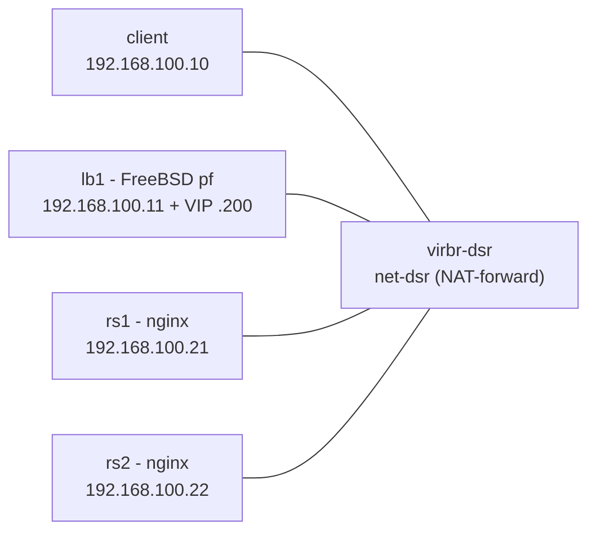
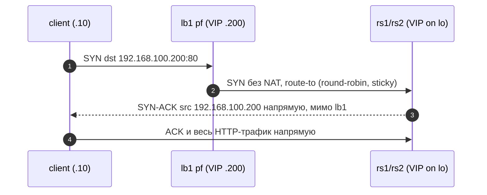

# lb-dsr-lab

Лаборатория на libvirt/QEMU: балансировка нагрузки с Direct Server Return
(DSR) на чистом pf во FreeBSD 14.5. Один балансировщик (lb1) перенаправляет
HTTP-трафик на два бэкенда nginx (rs1/rs2) без NAT, а бэкенды отвечают клиенту
напрямую, минуя балансировщик, подставляя VIP со своего loopback. Отдельная
VM-клиент нагружает VIP. Всё работает в одной изолированной libvirt-сети.

## Что показывает лаборатория

- Классическую схему DSR: client -> VIP -> pf `route-to` -> backend -> ответ
  напрямую клиенту (src=VIP, мимо lb1).
- Почему для DSR нужны: VIP /32 на loopback бэкендов, `arp_ignore`/
  `arp_announce` (иначе бэкенды перехватят VIP на L2), sloppy-состояния на pf
  (он видит только одну половину каждого TCP-потока).
- Разницу DSR и NAT на живом трафике: `just pf-mode nat` / `just pf-mode dsr`
  (тесты t02 и t06 фиксируют сигнатуру каждого режима по SYN/SYN-ACK).

## Топология

Изолированная сеть libvirt `net-dsr` (мост `virbr-dsr`), 192.168.100.0/24,
хост — 192.168.100.1. Адреса гостей СТАТИЧЕСКИЕ (cloud-init network-config), DHCP отключён — детерминированность лабы.
VIP = 192.168.100.200/32.

| VM     | IP              | MAC               | RAM      | vCPU | ОС | Роль |
|--------|-----------------|-------------------|----------|------|----|------|
| client | 192.168.100.10  | 52:54:00:aa:00:10 | 512 MiB  | 1    | Debian 13 genericcloud | клиент |
| lb1    | 192.168.100.11  | 52:54:00:aa:00:11 | 2048 MiB | 1    | FreeBSD 14.5 BASIC-CLOUDINIT (ufs) | pf DSR, VIP на vtnet0 |
| rs1    | 192.168.100.21  | 52:54:00:aa:00:21 | 768 MiB  | 1    | Debian 13 genericcloud | nginx, VIP на lo |
| rs2    | 192.168.100.22  | 52:54:00:aa:00:22 | 768 MiB  | 1    | Debian 13 genericcloud | nginx, VIP на lo |

Все диски — qcow2-оверлеи в пуле `default` (базовые тома
`freebsd-14.5-cloudinit.qcow2` и `debian-13-genericcloud.qcow2`), seed-ISO —
raw-тома `seed-*` (volid `cidata`).



Поток пакета в режиме DSR:



## Запуск

Sudo-шаги выполняет пользователь (не агент):

```bash
sudo pacman -S --needed libvirt qemu-full
sudo systemctl enable --now libvirtd.service
sudo usermod -aG libvirt "$USER"   # затем перелогиниться
sudo pacman -S --needed tcpdump wireshark-cli   # для дампов
sudo pacman -S --needed cdrtools xorriso        # для seed-ISO (mkisofs/xorriso)
```

Образы положить вручную (репозиторий ничего не скачивает):

```bash
mkdir -p ~/.local/share/lb-dsr-lab/images
# FreeBSD-14.5-RELEASE-amd64-BASIC-CLOUDINIT-ufs.qcow2  ->
cp <...> ~/.local/share/lb-dsr-lab/images/freebsd-14.5-cloudinit.qcow2
# debian-13-genericcloud-amd64.qcow2 ->
cp <...> ~/.local/share/lb-dsr-lab/images/debian-13-genericcloud.qcow2
```

Подъём и проверка:

```bash
just up        # сети, тома, seed-ISO, домены, ожидание DHCP (до 300 с)
just status
just test-all  # t00..t06
```

Первый запуск занимает несколько минут: cloud-init ставит пакеты на Debian VM
(nginx и утилиты). SSH-ключ создаётся автоматически в
`~/.local/share/lb-dsr-lab/ssh/`; вход — пользователь `lab`.

## Снятие дампов

Всё с хоста — через sudo (подробности в `tests/capture-hints.md`):

```bash
sudo tcpdump -ni virbr-dsr                       # весь лабораторный мост
virsh -c qemu:///system domiflist lb1            # vnetX конкретной VM
sudo tcpdump -ni vnetX
# внутри lb1 (у lab NOPASSWD sudo):
just ssh lb1
sudo tcpdump -ni vtnet0 'tcp[tcpflags] & (tcp-syn|tcp-ack) == (tcp-syn|tcp-ack)'
```

Сигнатура DSR — на lb1 видны SYN к VIP, но НЕТ ни одного SYN-ACK от VIP:
ответы уходят напрямую от бэкенда клиенту. В NAT-режиме lb1 видит обе
половины потока и SYN-ACK от VIP появляется.

## Тестовая матрица

Запуск: `just test-all` (одиночный — `just test 02`).

| Тест | Что проверяет |
|------|---------------|
| t00-smoke | все 4 VM пингуются с хоста, `hostname` по SSH совпадает |
| t01-arp | на ARP к VIP отвечает только MAC lb1 (arp_ignore на бэкендах работает) |
| t02-dsr | ядро лаборатории: SYN к VIP есть на lb1, SYN-ACK от VIP — ноль, оба бэкенда отвечают |
| t03-sticky | sticky-address привязывает источник: хост и клиент каждый на своём бэкенде |
| t04-backend-failure | nginx на rs1 остановлен — ошибки; `pfctl -T delete` — трафик идёт на rs2; восстановление |
| t05-mtu | 2 МиБ `big.bin` через DSR без обрыва + DF-пинг 1400 байт до VIP |
| t06-nat-compare | в NAT-режиме SYN-ACK от VIP появляется на lb1 (симметричный путь), затем возврат в DSR |

## pf DSR vs NAT

- **DSR** (`freebsd/pf-dsr.conf`): `pass in ... route-to (vtnet0 <webs>)
  round-robin sticky-address keep state (sloppy)`. Пакет не переписывается;
  бэкенд отвечает клиенту напрямую. Плюсы: исходящий трафик не проходит через
  LB, масштабируется почти линейно, LB не становится узким местом аплинка.
  Минусы: pf видит половину потока (нужны sloppy-состояния), нет прозрачной
  трансляции, сложнее health-checking.
- **NAT** (`freebsd/pf-nat.conf`): `rdr pass ... -> <webs> round-robin
  sticky-address`. Симметричный путь — все ответы через lb1 (pf-mode.sh
  добавляет на бэкендах хост-маршруты через 192.168.100.11, иначе ответы уйдут
  напрямую к клиенту, у которого нет NAT-состояния). Плюс: полный
  контроль/видимость потока на LB. Минус: вся нагрузка идёт через lb1.
- FreeBSD 14.x держит только legacy-синтаксис pf: нет `match`/`rdr-to`/
  `nat-to` — используются `rdr pass` и `pass ... route-to`.

## Известные ограничения

- Чистый pf не умеет health-checks: падение бэкенда обнаруживается только
  тестом t04 и лечится вручную через `pfctl -t webs -T delete`.
- Sloppy-состояния — осознанный компромисс асимметрии DSR: pf не увидит FIN/RST
  обратного пути и держит «полу-потоки» до таймаута.
- `sticky-address` держит источник на одном бэкенде, пока живо состояние
  (и запись source tracking) — с одного IP распределения по бэкендам не будет.
- TCP-offloads (tso/lro/gso, rxcsum/txcsum) выключены на всех VM — иначе
  дампы на мосту нечитаемы (GSO-сегменты и checksums на virtio).
- В NAT-режиме реплаи бэкендов заворачиваются через lb1 хост-маршрутами — это
  временная мера режима сравнения, а не свойство DSR.

## Phase 2: CARP

Заготовка на будущее: второй балансировщик lb2 и общий VIP через CARP
(`carp`-интерфейс с vhid/advbase), синхронизация состояний через pfsync,
DHCP-резервирование. Это даст отказоустойчивость самого балансировщика —
сейчас единственная точка отказа лаборатории. DSR-правила при этом не
меняются: route-to продолжает работать поверх виртуального CARP-адреса.
