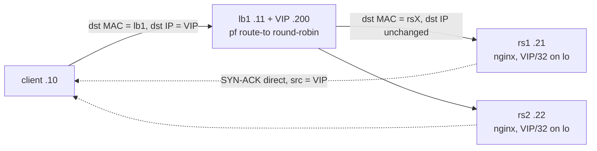
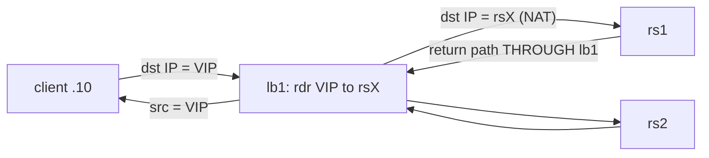

# HLD: lb-dsr-lab

Libvirt/QEMU lab demonstrating pure-pf L3/L4 load balancing on FreeBSD with
Direct Server Return toward Linux nginx backends.

## Components

| Node    | OS                | Role                          | Address (net-dsr)        |
|---------|-------------------|-------------------------------|--------------------------|
| host    | CachyOS           | libvirt, capture point        | 192.168.100.1 (virbr-dsr)|
| client  | Debian 13         | traffic source, arping        | 192.168.100.10           |
| lb1     | FreeBSD 14.5      | L3/L4 balancer (pf route-to)  | 192.168.100.11 + VIP .200|
| rs1/rs2 | Debian 13 + nginx | real servers (VIP on lo)      | .21 / .22 + VIP/32 on lo |

## Topology (DSR mode)

## NAT comparison mode

## Packet-flow decisions

- DSR: pf `route-to` forwards without address rewrite; backend replies never
  transit lb1, so pf tracks states with `(sloppy)`. VIP answers ARP only from
  lb1; backends suppress ARP (`arp_ignore=1`, `arp_announce=2`).
- All four VMs share one L2 segment (libvirt `net-dsr`, bridge `virbr-dsr`) -
  required for DSR, and makes every link sniffable from the host.
- TCP offloads are disabled on every NIC so host-side tcpdump shows real
  packet boundaries.

## Phase 2 (not built yet)

Second balancer `lb2` + CARP VHID on the VIP + pfsync over a dedicated
`net-sync` network (10.0.100.0/30); failover test kills lb1 under load.
