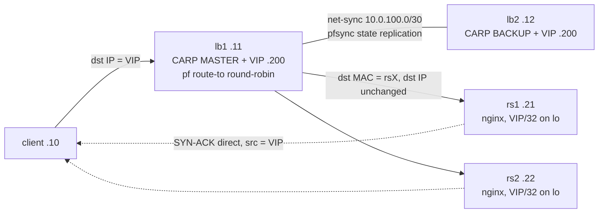
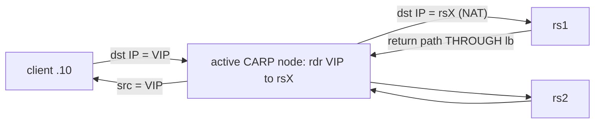
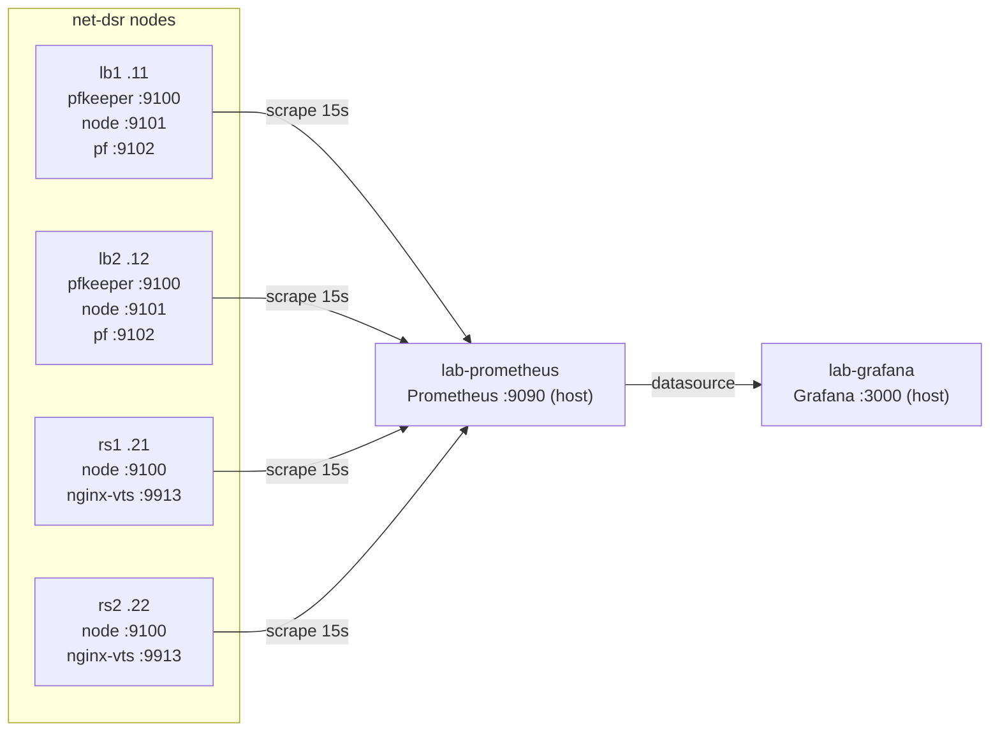

# HLD: lb-dsr-lab

Libvirt/QEMU lab demonstrating pure-pf L3/L4 load balancing on FreeBSD with
Direct Server Return toward Linux nginx backends. Phase 2 adds a CARP pair
(lb1 + lb2) on the shared VIP with pfsync state replication.

## Components

| Node    | OS                | Role                          | Address (net-dsr)        |
|---------|-------------------|-------------------------------|--------------------------|
| host    | CachyOS           | libvirt, capture point        | 192.168.100.1 (virbr-dsr)|
| client  | Debian 13         | traffic source, arping        | 192.168.100.10           |
| lb1     | FreeBSD 14.5      | L3/L4 balancer, CARP MASTER   | 192.168.100.11 + VIP .200|
| lb2     | FreeBSD 14.5      | L3/L4 balancer, CARP BACKUP   | 192.168.100.12 + VIP .200|
| rs1/rs2 | Debian 13 + nginx | real servers (VIP on lo)      | .21 / .22 + VIP/32 on lo |
| host    | CachyOS + Docker  | monitoring: Prometheus, Grafana (lab-prometheus, lab-grafana) | 127.0.0.1:9090 / :3000 |

Balancers carry a second NIC on `net-sync` (isolated L2 bridge `virbr-sync`,
no host IP, no DHCP): lb1 = 10.0.100.1/30, lb2 = 10.0.100.2/30 - pfsync only.
CARP: vhid 1, advskew 0 (lb1) / 100 (lb2), virtual MAC 00:00:5e:00:01:01,
`net.inet.carp.preempt=1` on both.

## Topology (DSR mode)

If lb1 dies, lb2 takes the VIP over (same CARP virtual MAC, pfsync keeps the
state table); DSR behavior is identical because both nodes run the same
ruleset (`freebsd/pf-dsr.conf`).

## NAT comparison mode

## Packet-flow decisions

- DSR: pf `route-to` forwards without address rewrite; backend replies never
  transit the balancer, so pf tracks states with `(sloppy)`. VIP answers ARP
  only with the CARP virtual MAC; backends suppress ARP (`arp_ignore=1`,
  `arp_announce=2`).
- CARP/pfsync control-plane rules use `keep state (no-sync)` so carp adverts
  (224.0.0.18 on vtnet0) and pfsync traffic (vtnet1) are not themselves
  replicated.
- All VMs share one L2 segment (libvirt `net-dsr`, bridge `virbr-dsr`) -
  required for DSR, and makes every link sniffable from the host. The sync
  link is a separate private segment (`net-sync`) so control-plane traffic
  never mixes with the data path.
- TCP offloads are disabled on every NIC so host-side tcpdump shows real
  packet boundaries.

## Observability

The host runs the monitoring stack (`monitoring/run.sh`): Prometheus and
Grafana in host-networked containers. Exporters live on the lab nodes:
pfkeeper :9100 + node_exporter :9101 + pf_exporter :9102 on the balancers,
node_exporter :9100 + nginx-vts :9913 on the backends - 10 scrape targets,
15s interval, static labels `cluster=lb-dsr-lab` / `role=lb|backend`.
Four Grafana dashboards; details in `docs/observability.md`.

## Phase 2 (built)

Second balancer `lb2` + CARP VHID 1 on the VIP + pfsync over the dedicated
`net-sync` network (10.0.100.0/30); failover is proven by
tests/t07-carp-failover.sh, which powers lb1 off under a live client request
loop and then boots it again. Status: `just carp`.
