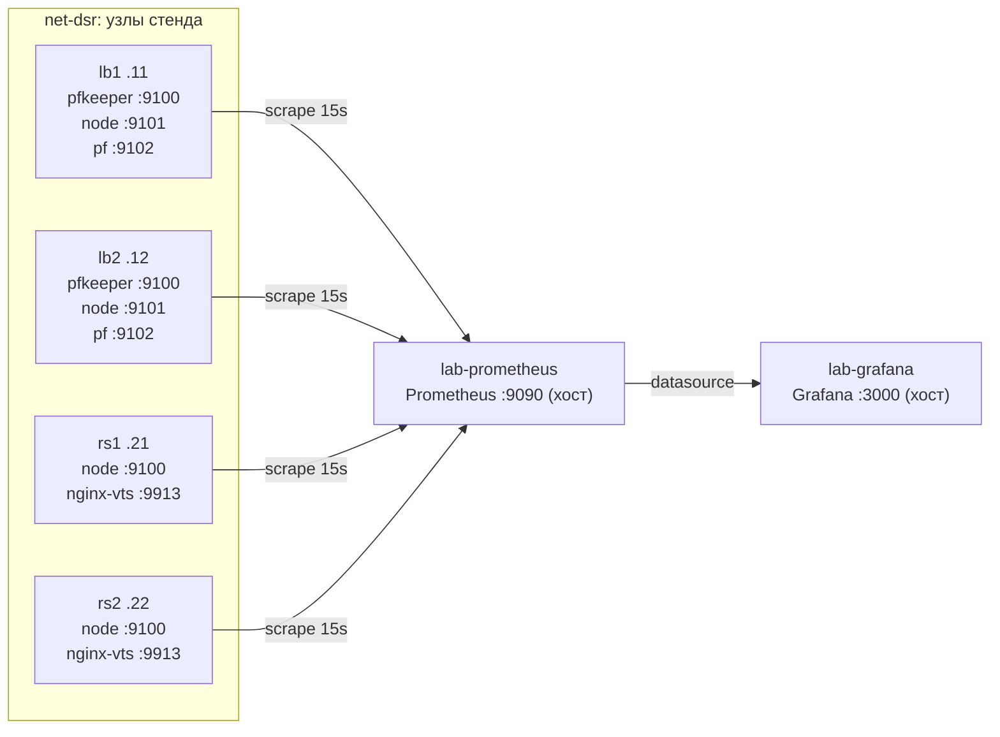

# Обсервербилити стенда lb-dsr-lab

Мониторный стек крутится на хосте в двух контейнерах (`lab-prometheus`,
`lab-grafana`, сеть `host`). Экспортеры уже развёрнуты на узлах стенда
и скрейпятся Prometheus'ом каждые 15 секунд.

## Схема



## Таргеты и порты

| Узел | Порт | Job | Что собирает |
|------|------|-----|--------------|
| lb1 / lb2 | 9100 | `pfkeeper` | CARP-роль, health членов, peer-статус, drift, service probability |
| lb1 / lb2 | 9101 | `node` | CPU/память/load/диск/сеть (FreeBSD node_exporter) |
| lb1 / lb2 | 9102 | `pf` | pf_states, счётчики match/insert/remove/search, таблицы |
| rs1 / rs2 | 9100 | `node` | CPU/память/load/диск/сеть (Debian node_exporter) |
| rs1 / rs2 | 9913 | `nginx-vts` | запросы по кодам, соединения, трафик nginx |

Статические лейблы у всех серий: `cluster=lb-dsr-lab`, `role=lb` (балансеры)
или `role=backend` (реальные серверы). Итого 10 таргетов.

## Запуск

```bash
cd monitoring && ./run.sh     # идемпотентно: пересоздаёт оба контейнера
docker rm -f lab-prometheus lab-grafana   # остановка
```

Конфиги лежат в `monitoring/` (см. `monitoring/README.md`); правки
`prometheus.yml` подхватываются после перезапуска `run.sh`.

## Дашборды (Grafana, папка lb-dsr-lab)

| Дашборд | Источник | Содержимое |
|---------|----------|------------|
| **FreeBSD nodes** | node_exporter lb1/lb2 | CPU %, load, память (FreeBSD-формула used = size − free − inactive − cache), UFS-диск, сеть vtnet, swap, uptime, CARP-роль |
| **pf balancers** | pf_exporter lb1/lb2 | pf_states, rate поисков состояний, insert/removal rate, match rate, адреса в таблицах, аномалии (fragment/short/mismatch) |
| **pfkeeper** | pfkeeper lb1/lb2 | service probability по членам, CARP-роль, member health, peer reachable/diverged/lag, drift, rate apply/probe/git-pull |
| **nginx backends (VTS)** | nginx-vts rs1/rs2 | req/s по кодам на каждом бэкенде и суммарно, доли 2xx/4xx/5xx, соединения по статусам, трафик, среднее время запроса |

У каждого дашборда есть переменная `instance` (мультивыбор, All по умолчанию).

## Как добавить таргет

1. Поднять экспортер на узле (узлы стенда не переинициализируются из этого
   репозитория — экспортеры ставятся отдельной волной, см. `exporters/`).
2. Добавить таргет в `monitoring/prometheus.yml` в соответствующий
   `job_name` (или завести новый), указав `labels: {cluster, role}`.
3. `cd monitoring && ./run.sh` — конфиг перемонтируется, таргет появится
   на `http://127.0.0.1:9090/targets`.

Известная особенность: `pfkeeper_service_probability` и `pfkeeper_apply_total`
экспортирует только MASTER-узел (lb1); у BACKUP (lb2) этих серий нет — это
поведение самого pfkeeper, а не мониторинга.
