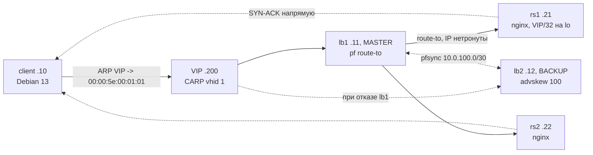

# Полный отчёт: lb-dsr-lab — L3/L4-балансировка на FreeBSD pf с DSR и отказоустойчивой CARP-парой

Дата: 2026-10-22. Стенд: `workspace/default/lb-dsr-lab`, 11 коммитов (`69565a9…8ab392e`)
Статус: **фазы 1 и 2 завершены** — DSR через CARP-пару работает, отказ балансировщика отработан под живым трафиком, run-all 8/8 PASS

---

## 1. Что построено

Тестовый стенд на libvirt/QEMU: **два балансировщика на FreeBSD 14.5 (чистый pf, без relayd)** в CARP-паре, DSR (Direct Server Return) на два nginx-бэкенда Debian 13, клиентская ВМ, полная наблюдаемость пакетов с хоста. Всё поднимается `just up` с нуля, проверяется `just test-all` (8 тестов).



## 2. Фаза 1 — DSR через один балансировщик (итоги)

- **Пакетное доказательство DSR** (одновременные `tcpdump -e` на lb1 и rs2): lb1 принимает SYN от клиента (dst MAC = lb1, dst IP = VIP) и выпускает тот же кадр на бэкенд (dst MAC = rsX, IP-пары нетронуты); SYN-ACK от VIP на lb1 **отсутствует** — rs2 отвечает клиенту напрямую (`52:54:00:aa:00:22 > 52:54:00:aa:00:10, .200.80 > .10.42290: Flags [S.]`).
- ARP-владение VIP: отвечает только балансировщик (на бэкендах `arp_ignore=1`).
- sticky-address per-source: host→rs1 40/40, client→rs2 10/10.
- Отказ бэкенда: стоп nginx rs1 → таймауты → `pfctl -t webs -T delete` → 6/6 через rs2 → re-add → восстановление.
- 2 МиБ через DSR — байт-в-байт; нагрузка ab 3000 req — **0 failed, 15 212 rps**.
- NAT-контраст на том же узле: rdr переписывает dst и src IP, SYN-ACK возвращается через LB (симметричный путь, полные стейты) — зафиксировано кадрами.

## 3. Фаза 2 — CARP-пара + pfsync (новое)

### 3.1 Конфигурация пары

| Параметр | lb1 | lb2 |
|---|---|---|
| DSR-сегмент (net-dsr) | .11 + CARP VIP .200/32 | .12 |
| Sync-сегмент (net-sync, изолированный /30) | 10.0.100.1 | 10.0.100.2 |
| CARP | vhid 1, advskew **0**, pass lbdsr | vhid 1, advskew **100** |
| pfsync0 | syncdev vtnet1, syncpeer .2 | syncdev vtnet1, syncpeer .1 |
| preempt | net.inet.carp.preempt=1 | тот же |

Правило pf общее для пары; в ruleset добавлены `pass proto carp keep state (no-sync)` и `pass proto pfsync keep state (no-sync)`.

### 3.2 Доказательства

**Выборы и виртуальный MAC.** После подъёма пары: lb1 `carp: MASTER vhid 1 advskew 0`, lb2 `carp: BACKUP vhid 1 advskew 100`. arping VIP с клиента отвечает **CARP-виртуальным MAC**:

```
Unicast reply from 192.168.100.200 [00:00:5E:00:01:01]  1.093ms
Unicast reply from 192.168.100.200 [00:00:5E:00:01:01]  1.327ms
```

**Репликация pfsync.** После 10 запросов клиента: на lb1 (MASTER) 20 стейтов, на lb2 (BACKUP) — **14 реплицированных**, включая идентичные записи (`192.168.100.200:80 <- 192.168.100.10:49814 FIN_WAIT_2:CLOSING`). Кадры pfsync на vtnet1:

```
09:42:16.405090 IP 10.0.100.1 > 10.0.100.2: PFSYNCv5 len 1413
09:42:16.405128 IP 10.0.100.1 > 10.0.100.2: PFSYNCv5 len 582
```

**Отказ lb1 под живым трафиком (t07).** Клиент крутит 120 запросов (curl -m2, интервал 0.1 c); в середине цикла lb1 выключается (`shutdown -p now`):

- результат цикла: **ok=119, fail=1** — простой составил ~2 с ( advbase 1 + advskew), lb2 взял VIP как MASTER;
- роли после переключения: lb2 `carp: MASTER advskew 100`;
- возврат lb1: загрузка ~2 мин, с `preempt=1` + advskew 0 lb1 **сразу возвращает MASTER**, lb2 уходит в BACKUP, «master count: 1» — раздвоения нет;
- PASS: `CARP failover ok: loop ok=119 fail=1, lb2 took over, lb1 recovered`.

### 3.3 Грабли фазы 2 (все закрыты)

1. **carp.ko/pfsync.ko — модули, не GENERIC**: CARP-алиас падал с «Protocol not supported», pfsync0 не создавался, `net.inet.carp.preempt` — unknown oid. Фикс: `kldload carp/pfsync` в runcmd + `kld_list="carp pfsync"` для последующих бутов.
2. **UEFI-домены требуют `virsh undefine --nvram`**: первый undefine молча провалился — lb1 остался на старом определении **с одной NIC** (нет vtnet1 → pfsync не мог привязаться). Диагноз: `virsh dumpxml | grep -c "<interface "`.
3. **tcpdump на FreeBSD не знает `proto carp`** — использовать `proto 112` (CARP) и `proto 240` (pfsync).
4. **Гонка первого бута pfsync0**: интерфейс создан до vtnet1 → syncdev не применился; лечится `ifconfig pfsync0 down; ifconfig pfsync0 syncdev vtnet1 syncpeer ... up` (после перезагрузки rc.conf делает это сам).
5. **nuageinit флейм первого бута** (может остановиться после стадии users — статика/ключи/runcmd не применяются): задокументирован в README + процедура починки без вайпа (правка UFS-диска через hot-attach к здоровому узлу). Мультиlasticast CARP через virbr-dsr с `multicast_snooping=1` прошёл без проблем.

## 4. Сводные технические данные

| Метрика | Значение |
|---|---|
| Тесты | run-all **8/8 PASS** (t00 smoke, t01 ARP, t02 DSR-дампы, t03 sticky, t04 отказ бэкенда, t05 MTU, t06 NAT-сравнение, t07 CARP-failover) |
| Нагрузка через DSR | ab 3000 req, c=10: **15 212 rps**, 0 failed, 4.47 MB/s |
| Простой при отказе LB | 1 запрос из 120 (curl -m2) ≈ 2 с |
| Репликация pfsync | стейты MASTER→BACKUP (20→14 в момент замера), кадры PFSYNCv5 по 10.0.100.0/30 |
| Задержка GET host→VIP | 2.2–2.8 мс |
| Ресурсы стенда | 5 ВМ, ~10 ГБ ОЗУ суммарно, ~6 ГБ на диске (образы+оверлеи) |

## 5. Воспроизведение коллегой

```bash
git clone <repo> && cd lb-dsr-lab
# prerequisites: libvirt + qemu (группа libvirt), OVMF, genisoimage|mkisofs|xorriso,
# tcpdump; см. README «Prerequisites»
just up          # скачанные образы кладутся в ~/.local/share/lb-dsr-lab/images
just test-all    # 8 тестов, ~10 мин (t07 дважды перезагружает lb1)
just carp        # статус CARP-пары
just pf-mode nat # переключение DSR -> NAT и обратно
just down        # погасить всё
```

SSH: `lab@` (Debian), `root@` (FreeBSD), ключ генерируется автоматически при первом `just up` (в репо не хранится). Секретов в репо нет; образы/диски/pcap в git не попадают (.gitignore).

## 6. Известные ограничения

- nuageinit флейм первого бута — см. README Troubleshooting (обход: повторный `just down/up` для узла; процедурный фикс — правка диска через hot-attach).
- Health-check'ов в чистом pf нет (осознанно): таблица `<webs>` правится `pfctl -T`; опция развития — relayd поверх тех же таблиц.
- CARP-пара защищает только ingress-путь (DSR-ответы всегда идут мимо балансировщиков) — это свойство DSR, не дефект.
- `bench.sh` на хосте требует `hey`/`ab` (или запускать ab внутри client ВМ, как в отчёте).

## 7. Журнал

Все работы и причины решений: `Проекты/lb-dsr-lab/Журнал.md`, дашборд обновлён, journald `journalctl -t zcode-agent`.
